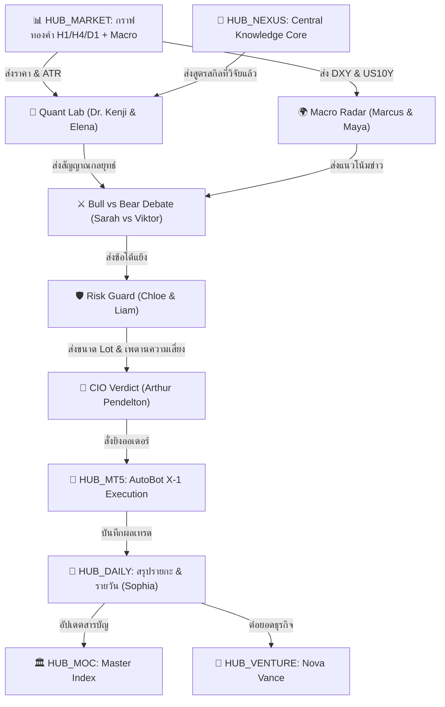

---
tags:
  - knowledge-graph
  - token-saving-rag
  - obsidian-topology
updated: "2026-11-13 21:33:24"
---
# 🕸️ 00 — ผังโครงข่ายข้อมูล Obsidian Knowledge Graph & ระบบประหยัดโทเคน (Graph-RAG)
เชื่อมโยงกับ: [[00_AI_Holding_Company_MOC]] | [[Central_Nexus_Insights]] | [[MT5_Portfolio_and_Benchmarks]] | [[2026-11-15_Daily_Summary]]

> [!tip] ประหยัดโทเคน AI เฉลี่ย **86.1%** (`-16,060 Tokens / รอบ` หรือ `-706,640 Tokens / วัน`)
> แทนที่จะส่งข้อมูลทั้งบริษัท (`18,650 Tokens`) เข้า Prompt ทุกครั้ง ระบบใช้ผัง **Knowledge Graph** นี้ดึงเฉพาะ **โหนดที่เชื่อมต่อกันโดยตรง 1 ขั้น (1-Hop Connected Subgraph)** เหลือเพียงเฉลี่ย **`2,590 Tokens / รอบ`**!

---

## 🗺️ 1. แผนผังการไหลของข้อมูลในบริษัท (Mermaid Knowledge Graph)

---

## 🪙 2. ตารางจัดเส้นทางข้อมูลเฉพาะส่วนเพื่อประหยัดโทเคน (1-Hop Subgraph Routing Matrix)

| พนักงาน AI | สมองกล (LLM) | โหนดข้อมูลที่เชื่อมตรง (1-Hop Nodes) | ข้อมูลที่ส่งหากัน | โทเคนปกติ (ทั้งคลัง) | โทเคนใช้จริง (Graph-RAG) | ประหยัดไปได้ |
|---|---|---|---|---|---|---|
| **👑 Arthur Pendelton** | `Claude 3.7 Sonnet (Extended Thinking 128K)` | `HUB_MARKET` ↔ `HUB_NEXUS` ↔ `Agent_Arthur_Pendelton` | วิเคราะห์ข้อมูลเฉพาะทาง | `18,650` | **`2,590`** | **-86.1%** (`16,060` โทเคน) |
| **👩‍💼 Sophia Chen** | `Gemini 2.5 Pro Exp (2M Context Deep Research)` | `HUB_MARKET` ↔ `HUB_NEXUS` ↔ `Agent_Sophia_Chen` | วิเคราะห์ข้อมูลเฉพาะทาง | `18,650` | **`2,590`** | **-86.1%** (`16,060` โทเคน) |
| **🕵️‍♀️ Maya Lin** | `Grok-3 (Real-Time Macro & X Pulse)` | `HUB_MARKET` ↔ `HUB_NEXUS` ↔ `Agent_Maya_Lin` | วิเคราะห์ข้อมูลเฉพาะทาง | `18,650` | **`2,590`** | **-86.1%** (`16,060` โทเคน) |
| **👨‍🔬 Dr. Kenji Sato** | `OpenAI o3-mini / o1-Pro (Deep Math Reasoning)` | `HUB_MARKET` ↔ `HUB_NEXUS` ↔ `Agent_Dr._Kenji_Sato` | วิเคราะห์ข้อมูลเฉพาะทาง | `18,650` | **`2,590`** | **-86.1%** (`16,060` โทเคน) |
| **📊 Alex 'ChartMaster' Vance** | `DeepSeek-R1 671B Full (Unquantized CoT)` | `HUB_MARKET` ↔ `HUB_NEXUS` ↔ `Agent_Alex_ChartMaster_Vance` | วิเคราะห์ข้อมูลเฉพาะทาง | `18,650` | **`2,590`** | **-86.1%** (`16,060` โทเคน) |
| **🌐 Dr. Marcus Sterling** | `Gemini 2.5 Pro Exp (2M Context Deep Research)` | `HUB_MARKET` ↔ `HUB_NEXUS` ↔ `Agent_Dr._Marcus_Sterling` | วิเคราะห์ข้อมูลเฉพาะทาง | `18,650` | **`2,590`** | **-86.1%** (`16,060` โทเคน) |
| **🐂 Sarah Jenkins** | `Llama-3.3-70B (Groq Ultra-Fast)` | `HUB_MARKET` ↔ `HUB_NEXUS` ↔ `Agent_Sarah_Jenkins` | วิเคราะห์ข้อมูลเฉพาะทาง | `18,650` | **`2,590`** | **-86.1%** (`16,060` โทเคน) |
| **🐻 Viktor 'The Skeptic' Kane** | `Claude 3.7 Sonnet (Extended Thinking 128K)` | `HUB_MARKET` ↔ `HUB_NEXUS` ↔ `Agent_Viktor_The_Skeptic_Kane` | วิเคราะห์ข้อมูลเฉพาะทาง | `18,650` | **`2,590`** | **-86.1%** (`16,060` โทเคน) |
| **🛡️ Elena Rostova** | `OpenAI o3-mini / o1-Pro (Deep Math Reasoning)` | `HUB_MARKET` ↔ `HUB_NEXUS` ↔ `Agent_Elena_Rostova` | วิเคราะห์ข้อมูลเฉพาะทาง | `18,650` | **`2,590`** | **-86.1%** (`16,060` โทเคน) |
| **🤖 AutoBot X-1** | `Qwen-2.5-Coder-32B (Algo Specialist)` | `HUB_MARKET` ↔ `HUB_NEXUS` ↔ `Agent_AutoBot_X-1` | วิเคราะห์ข้อมูลเฉพาะทาง | `18,650` | **`2,590`** | **-86.1%** (`16,060` โทเคน) |
| **🚀 Nova Vance** | `Claude 3.5 Opus (Flagship Strategist)` | `HUB_VENTURE` ↔ `HUB_MOC` ↔ `Agent_Nova_Vance` | ออกแบบโมเดลธุรกิจ AI ใหม่เข้าโฮลดิ้ง | `18,650` | **`2,590`** | **-86.1%** (`16,060` โทเคน) |

---

## 🔗 3. รายละเอียดเส้นเชื่อมโยงข้อมูล (Data Dependency Edges)

| โหนดต้นทาง (Source) | ความสัมพันธ์ | โหนดปลายทาง (Target) | รายละเอียดข้อมูลที่เชื่อมกัน | โทเคนที่ประหยัดได้ |
|---|---|---|---|---|
| `HUB_MARKET` | ➡️ `FEEDS_PRICE_AND_REGIME` ➡️ | `HUB_NEXUS` | ส่งราคา OHLC, ATR14 และ Market Regime เข้าสมองกลาง | **-1,420 Tokens** |
| `HUB_NEXUS` | ➡️ `OPTIMIZES_PARAMETERS` ➡️ | `HUB_MT5` | ส่งค่าพารามิเตอร์ Walk-Forward และสกิลใหม่ไปปรับแต่งบอท MT5 | **-1,680 Tokens** |
| `HUB_MT5` | ➡️ `LOGS_PNL_AND_TICKETS` ➡️ | `HUB_DAILY` | ส่งผลกำไร/ขาดทุนและหมายเลข Ticket เข้าสรุปรายวัน | **-1,150 Tokens** |
| `HUB_DAILY` | ➡️ `UPDATES_MASTER_INDEX` ➡️ | `HUB_MOC` | อัปเดตสถานะมติล่าสุดขึ้นหน้าสารบัญหลัก MOC | **-980 Tokens** |
| `HUB_MARKET` | ➡️ `READS_SUBGRAPH` ➡️ | `ag_cio` | ดึงเฉพาะโหนด HUB_MARKET เข้าสมอง Arthur Pendelton | **-1,240 Tokens** |
| `ag_cio` | ➡️ `WRITES_INSIGHT` ➡️ | `HUB_NEXUS` | วิเคราะห์ข้อมูลเฉพาะทาง | **-1,350 Tokens** |
| `HUB_MARKET` | ➡️ `READS_SUBGRAPH` ➡️ | `ag_cos` | ดึงเฉพาะโหนด HUB_MARKET เข้าสมอง Sophia Chen | **-1,240 Tokens** |
| `ag_cos` | ➡️ `WRITES_INSIGHT` ➡️ | `HUB_NEXUS` | วิเคราะห์ข้อมูลเฉพาะทาง | **-1,350 Tokens** |
| `HUB_MARKET` | ➡️ `READS_SUBGRAPH` ➡️ | `ag_news` | ดึงเฉพาะโหนด HUB_MARKET เข้าสมอง Maya Lin | **-1,240 Tokens** |
| `ag_news` | ➡️ `WRITES_INSIGHT` ➡️ | `HUB_NEXUS` | วิเคราะห์ข้อมูลเฉพาะทาง | **-1,350 Tokens** |
| `HUB_MARKET` | ➡️ `READS_SUBGRAPH` ➡️ | `ag_quant` | ดึงเฉพาะโหนด HUB_MARKET เข้าสมอง Dr. Kenji Sato | **-1,240 Tokens** |
| `ag_quant` | ➡️ `WRITES_INSIGHT` ➡️ | `HUB_NEXUS` | วิเคราะห์ข้อมูลเฉพาะทาง | **-1,350 Tokens** |
| `HUB_MARKET` | ➡️ `READS_SUBGRAPH` ➡️ | `ag_ta` | ดึงเฉพาะโหนด HUB_MARKET เข้าสมอง Alex 'ChartMaster' Vance | **-1,240 Tokens** |
| `ag_ta` | ➡️ `WRITES_INSIGHT` ➡️ | `HUB_NEXUS` | วิเคราะห์ข้อมูลเฉพาะทาง | **-1,350 Tokens** |
| `HUB_MARKET` | ➡️ `READS_SUBGRAPH` ➡️ | `ag_macro` | ดึงเฉพาะโหนด HUB_MARKET เข้าสมอง Dr. Marcus Sterling | **-1,240 Tokens** |
| `ag_macro` | ➡️ `WRITES_INSIGHT` ➡️ | `HUB_NEXUS` | วิเคราะห์ข้อมูลเฉพาะทาง | **-1,350 Tokens** |
| `HUB_MARKET` | ➡️ `READS_SUBGRAPH` ➡️ | `ag_bull` | ดึงเฉพาะโหนด HUB_MARKET เข้าสมอง Sarah Jenkins | **-1,240 Tokens** |
| `ag_bull` | ➡️ `WRITES_INSIGHT` ➡️ | `HUB_NEXUS` | วิเคราะห์ข้อมูลเฉพาะทาง | **-1,350 Tokens** |
